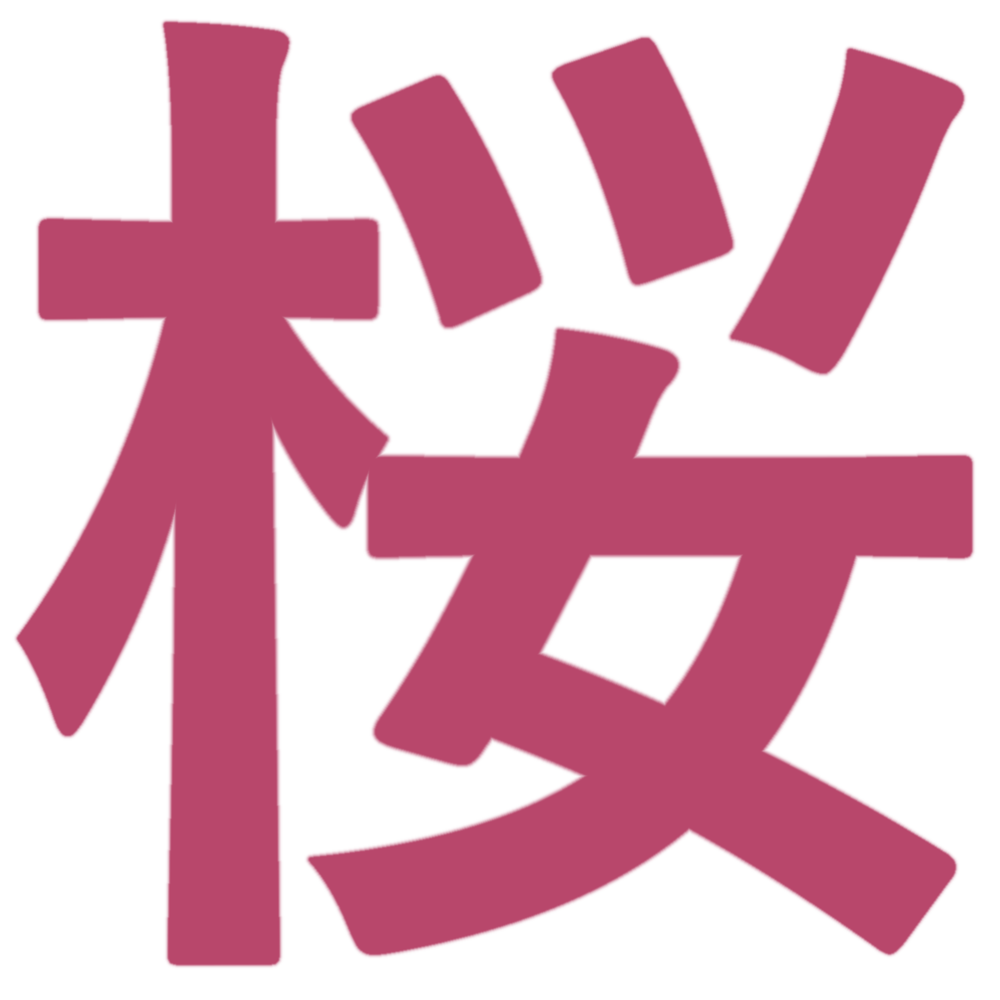

<div align="center">

  

  # 🌸 Sakura Launcher

  **Быстрый, стильный и современный лаунчер для Minecraft на базе Electron и TypeScript.**

  [](LICENSE)
  [](https://www.electronjs.org/)
  [](https://www.typescriptlang.org/)
  [](https://minecraft.net/)

</div>

---

## ✨ Основные особенности

- 🌸 **Эстетичный интерфейс**: Чистый, интуитивный дизайн в стиле Sakura с плавными анимациями.
- 🔑 **Мульти-аккаунты**:
  - **Microsoft** (через официальный OAuth/msmc)
  - **Ely.by** (Yggdrasil auth)
  - **Offline** (локальный режим)
- 🎮 **Discord Rich Presence (RPC)**: Показывает текущий статус и версию игры прямо в профиле Discord.
- 🔒 **Безопасность**: Учетные данные шифруются на уровне ОС с использованием Electron `safeStorage` (DPAPI).
- ⚡ **Высокая производительность**: Оптимизированный запуск версий Minecraft через `minecraft-launcher-core`.
- 📦 **Поддержка сборок**: Генерация Portable и NSIS-инсталляторов для Windows.

---

## 🛠 Стек технологий

- **Фреймворк:** [Electron](https://www.electronjs.org/)
- **Язык:** [TypeScript](https://www.typescriptlang.org/)
- **Интеграции:**
  - `minecraft-launcher-core` — ядро запуска и скачивания игровых файлов
  - `msmc` — авторизация Microsoft/Xbox Live
  - `discord-rpc` — интеграция с Discord
  - `electron-builder` — сборка дистрибутивов и установщиков

---

## 🚀 Установка и запуск для разработки

### 1. Клонирование репозитория
```bash
git clone https://github.com/avtotronix/sakura-launcher.git
cd sakura-launcher
```

### 2. Установка зависимостей
```bash
npm install
```

### 3. Запуск в режиме разработки
```bash
npm run dev
```

---

## 📦 Сборка дистрибутивов

- **Сборка приложения (директория):**
  ```bash
  npm run pack
  ```

- **Сборка инсталлятора Windows (NSIS):**
  ```bash
  npm run dist
  ```

- **Сборка Portable-версии:**
  ```bash
  npm run dist:portable
  ```

Собранные бинарники появятся в папке `release/`.

---

## 📄 Лицензия

Этот проект распространяется под лицензией **MIT**. Подробности в файле [LICENSE](LICENSE).

<div align="center">
  <sub>Разработано с ❤️ командой Sakura Launcher</sub>
</div>
